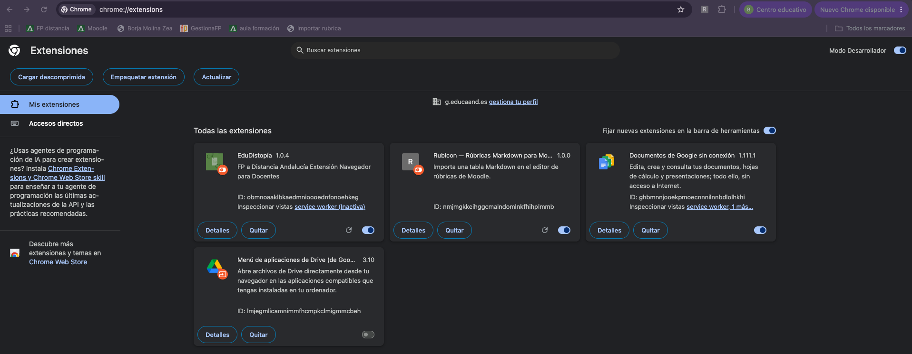
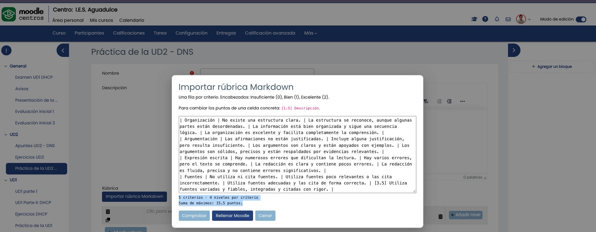
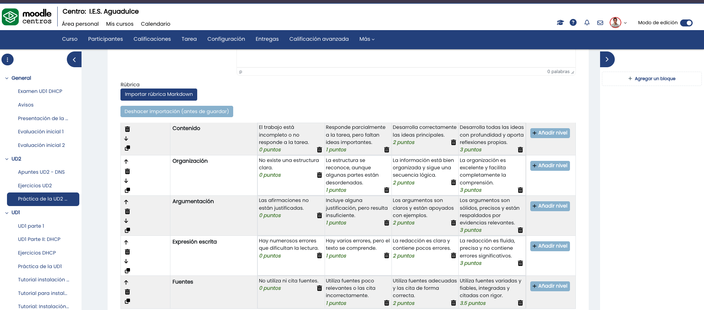

# Rubicon

Extensión de navegador para importar rúbricas escritas como tablas Markdown en el editor de rúbricas de Moodle. Rubicon rellena el formulario, pero **nunca lo
guarda automáticamente**: podrás revisar el resultado antes de pulsar el botón de guardado de Moodle.

## Instalar en Chrome, Edge, Brave u otro navegador Chromium

1. En GitHub, pulsa **Code** y después **Download ZIP** para descargar el repositorio como archivo `.zip`.
2. Descomprime el archivo `.zip` y deja la carpeta resultante en una ubicación permanente. No cargues directamente el archivo comprimido.
3. Abre la página de extensiones del navegador:
   - Chrome: `chrome://extensions`
   - Edge: `edge://extensions`
   - Brave: `brave://extensions`
4. Activa **Modo de desarrollador**.
5. Pulsa **Cargar descomprimida** y selecciona la carpeta que acabas de descomprimir (la que contiene `manifest.json`).



## Usar Rubicon

1. En Moodle, abre una actividad, entra en calificación avanzada, elige rúbrica y nuevo formulario desde cero.
2. Encima de la rúbrica verás **Importar rúbrica Markdown**.
3. Pulsa el botón, pega tu tabla (se la pides a la IA, le pasas tu documento con tu rúbrica o incluso una captura de pantalla) y usa **Comprobar** para validarla.



4. Pulsa **Rellenar Moodle** y confirma la sustitución de las filas actuales.



5. Revisa criterios, descripciones y puntos. Si algo no está bien, usa
   **Deshacer importación (antes de guardar)**.
6. Guarda la rúbrica con el botón normal de Moodle cuando estés conforme.

## Formato Markdown

Puedes comenzar con la [rúbrica de ejemplo](RUBRICA_EJEMPLO.md), copiar su
tabla completa y pegarla en Rubicon.

La primera columna contiene el criterio. Cada encabezado de nivel debe acabar
con su puntuación entre paréntesis:

```md
| Criterio | Insuficiente (0) | Bien (1) | Excelente (2) |
|---|---|---|---|
| Contenido | Incompleto | Correcto | Completo y bien argumentado |
| Presentación | Difícil de seguir | Clara | Muy clara y cuidada |
```

La puntuación del encabezado se aplica a todas las filas. Para asignar una
puntuación diferente a una celda concreta, comienza su texto con `[puntos]`:

```md
| Fuentes | No se citan | Se citan parcialmente | [2.5] Citas completas y correctas |
```

Se aceptan decimales con punto o coma, puntuaciones negativas y `<br>` para
crear saltos de línea dentro de una celda. Si necesitas escribir una barra
vertical dentro del texto, escápala como `\|`.

## Privacidad y seguridad

La extensión no envía datos a ningún servidor, no hace peticiones de red y no
guarda el texto pegado. Se carga en páginas HTTP/HTTPS porque cada instalación
de Moodle puede usar un dominio distinto, pero solo muestra su botón cuando
detecta el editor editable de rúbricas de Moodle.

## Compatibilidad

La extensión usa Manifest V3 y está pensada para navegadores basados en
Chromium. Su funcionamiento depende de la estructura interna del editor de
rúbricas de Moodle; si una versión futura de Moodle la cambia, puede ser
necesario adaptar `rubicon.js`.
